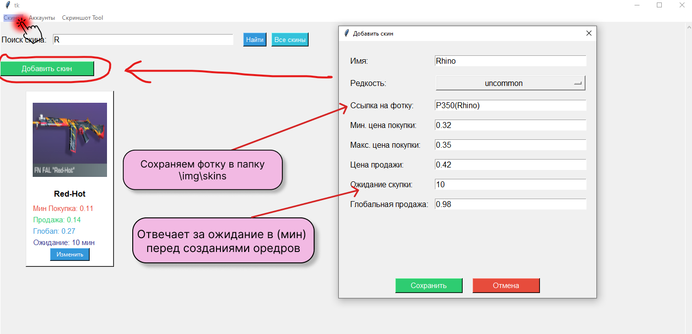
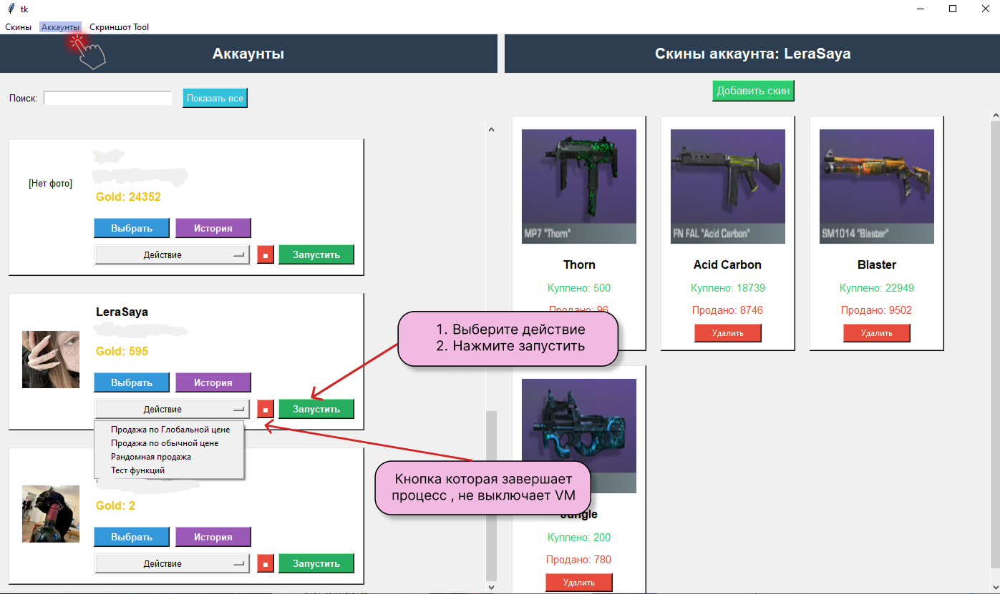
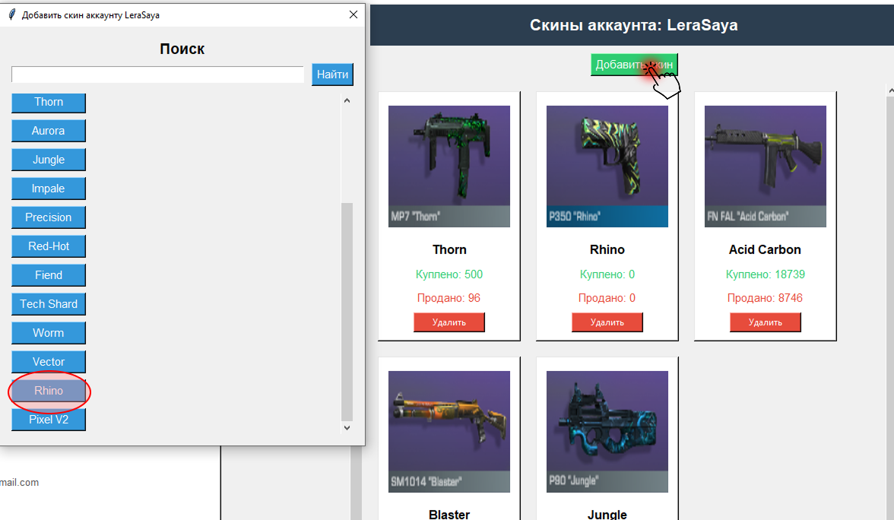
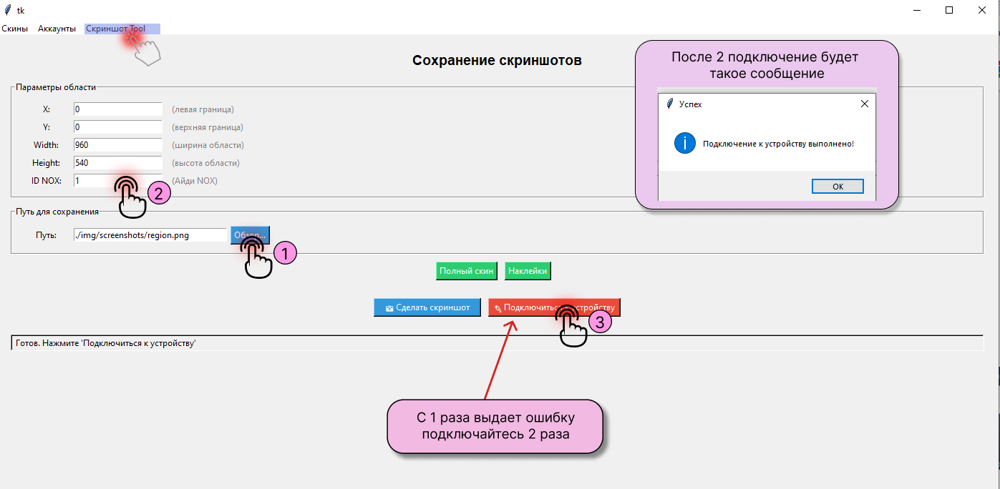

# Standoff 2 Market Automation

Прототип автоматизации операций на внутриигровом рынке Standoff 2. Приложение взаимодействует с Android-эмулятором через Appium, распознаёт элементы интерфейса и отдельные значения на экране с помощью компьютерного зрения, а состояние аккаунтов и скинов хранит в PostgreSQL.

> **Статус:** личный экспериментальный проект. Перед запуском на реальном аккаунте проверьте правила игры и платформы, работайте с тестовыми данными и учитывайте риск ограничений аккаунта. Это не финансовый торговый бот и не инструмент для торговли реальными активами.

## Возможности

- Поиск элементов игрового интерфейса по шаблонам с OpenCV.
- Распознавание чисел и игрового баланса с EasyOCR и обработкой изображений.
- Управление Android-эмулятором и действиями в приложении через Appium и Selenium.
- Логика выставления заявок на покупку и продажу внутриигровых скинов.
- Хранение цен, настроек аккаунтов и истории в PostgreSQL.
- Tkinter-интерфейс для просмотра данных и вспомогательных операций со скриншотами.

## Технологии

Python · OpenCV · EasyOCR · Tesseract · Pillow · Appium · Selenium · ADB · PostgreSQL · psycopg2 · Tkinter

## Структура проекта

```text
actions/          поиск шаблонов и действия касания
config/           локальная конфигурация эмулятора, Appium и БД
core/             модели, управление устройствами, драйвером и сессиями
services/         торговая логика и доступ к PostgreSQL
TollStandoff/     Tkinter-интерфейс - для работы с базой данных
img/              шаблоны интерфейса, скинов и тестовые скриншоты
main.py           функции сценариев автоматизации
startFile.py      интерактивный запуск сценария
sql/schema.sql    sql запрос дял создания таблиц
requiremenrs.txt  библиотеки испольюзыемые в проекте
```

## Требования

- Windows и Python.
- Android-эмулятор, настроенный для ADB; пути в текущей конфигурации рассчитаны на LDPlayer.
- Node.js и Appium с драйвером UiAutomator2; для текущей конфигурации также используется Appium Images plugin.
- PostgreSQL с подготовленными таблицами и данными проекта. (все в файле schema.sql)
- Tesseract OCR и модели EasyOCR `english_g2.pth`, `craft_mlt_25k.pth`, `cyrillic_g2.pth`.
- Python-библиотеки, используемые исходным кодом: `opencv-python`, `numpy`, `Pillow`, `easyocr`, `pytesseract`, `selenium`, `Appium-Python-Client`, `psycopg2`, `python-dotenv` .


## Настройка
1. Скачайте LDplayer -> создайте android 9 версии(Обязательно поменяйте разрешение на Телефон "540x960") -> в настройках VM включитель отладку по adb (локально) -> скачайте standoff 2 -> войдите в аккаунт , и пополните gold

2. Нужно импортировать все таблицы из файла `sql/schema.sql` -> и изменить INSERT INTO public.account в конце файла

3. Создайте локальный файл `.env` (не добавляйте в Git) с параметрами подключения к PostgreSQL и адресом Appium:

   ```dotenv
   DB_HOST=127.0.0.1
   DB_PORT=5432
   DB_NAME=your_database
   DB_USER=your_user
   DB_PASSWORD=your_password
   APPIUM_HOST=127.0.0.1 или localhost 
   ```

4. Укажите актуальные локальные пути к эмулятору и Tesseract, а также сетевые параметры в [config/configall.py](config/configall.py).

5. Установите EasyOCR-модели в каталог, который ожидает приложение. Заменить путь папки моделей в [config/configall.py](config/configall.py)


## Запуск

Запуск графического интерфейса:

```powershell
python -m TollStandoff
```

## Известные ограничения

- **Локальные пути и сетевые значения.** Конфигурация содержит пути и адреса, привязанные к конкретной машине. Перед переносом проекта на другой компьютер их нужно заменить (см. `config/configall.py`).

- **Зависимость от разрешения и языка интерфейса.** Автоматизация опирается на координаты и изображения элементов игры. При изменении разрешения, языка или после обновления игры (смены цвета фона) поиск элементов может сломаться — в консоли будет указан путь к изображению, которое не найдено.

- **Бесконечные циклы и повторные попытки.** Часть скриптов запускает длительные циклы с повторными попытками. Перед продолжительной работой требуется дополнительная обработка ошибок и корректное завершение процессов.

> **Совет.** Если элементы интерфейса не находятся, проверьте эталонные изображения в папке `img/interfaces` — они используются для поиска на экране. Чтобы подобрать актуальные координаты и цвета под своё разрешение, откройте вкладку **«Скриншот Tool»** в GUI, введите туда координаты области и сравните свой диапазон цветов с эталонным.


## Идеии для обновления
- Сделать отладку для каждого устройства не в консоли , а в интрефейсе , так же добавить фильт к этой отладке

- Сделать отображения истории каждому аккаунту: Сколько голоды убавилось за день , сколько скинов куплено (начал делать , но забросил)

## Инструкция по ToolStandoff

### 1. Окно для добавления скинов



При запуске открывается главное окно с тремя вкладками сверху. Вкладка **«Скины»** — первая, в ней отображаются карточки скинов из базы данных. Здесь расположены:

- **Поле «Поиск скина»** — фильтрует скины по названию, введённому в поле.
- **Карточки скинов** — показывают краткую информацию о скине и кнопку «Изменить».
- **Кнопка «Добавить скин»** — открывает окно для добавления нового скина в базу данных.
- **Кнопка «Изменить»** — открывает окно для изменения скина в базе данных.
- **Поле «Ссылка на фотку»** — путь к изображению скина.

> **Совет.** Чтобы добавить фотку к скину, воспользуйтесь вкладкой **«Скриншот Tool»** (третья вкладка) — она позволяет сделать скриншот скина прямо из эмулятора. Подробная инструкция — в [разделе 4](#4-вкладка-скриншот-tool).

### 2. Вкладка «Аккаунты»



Вкладка **«Аккаунты»** — вторая, в ней отображаются карточки аккаунтов из базы данных. Здесь расположены:

- **Поле «Поиск»** — фильтрует карточки аккаунтов по названию, введённому в поле.
- **Карточки аккаунтов** — показывают информацию о балансе и кнопки «Выбрать», «История», «Действия», «Стоп», «Запустить».
- **Кнопка «Добавить скин»** — открывает окно для привязки скина к выбранному аккаунту (показано на скриншоте 3).

#### Кнопки карточки аккаунта

1. **«Выбрать»** — в правом столбце «Скины аккаунта» показывает карточки скинов, привязанных к этому аккаунту.
2. **«История»** — зарезервирована для будущей функции отображения изменений скинов и баланса в виде графика.
3. **«Действия»** — выпадающий список с выбором режима работы:
   - **«Продажа по обычной цене»** — покупка скинов: выставляет запросы на скины, привязанные к аккаунту. Если запросы уже стоят (опирается на интервал покупки, указанный в поле «Ожидание скупки»), скрипт выставляет случайные скины на рынок, чтобы устройство не простаивало. Скин выставляется, если с момента последней продажи прошло более 2 минут. Количество продаваемых скинов задаётся параметром `skin_count_sell` в функции `TradeByuSell` (по умолчанию `(20, 25)` — случайное число от 20 до 25). Цена берётся из поля «Цена продажи».
   - **«Продажа по глобальной цене»** — то же самое, но цена берётся из поля «Глобальная продажа».
   - **«Рандомная продажа»** — продаёт случайные скины из привязанных к аккаунту.   Количество продаваемых скинов задаётся параметром `count_sell` в функции  `sell_random_skins` (по умолчанию `(80, 140)` — случайное число от 80 до 140). При   большом количестве скинов (20 000–30 000+) аккаунт начинает лагать.
   - **«Тест функций»** — для тестирования отдельных функций в коде. Если нужно что-то проверить, меняйте функцию `custom_buy` в файле `main.py`.
4. **«Стоп»** — завершает процесс, выбранный в списке «Действия», но не выключает VM. Можно переключиться на другое действие.
5. **«Запустить»** — запускает выбранный скрипт из списка «Действия».

### 3. Меню привязки скина к аккаунту



Меню **«Добавить скин аккаунту»** отображает список имён всех скинов из базы данных и поле поиска нужного скина. На скриншоте выделен скин **«Rhino»**, который мы добавили в разлеле 1.

При нажатии на скин из списка его id и id аккаунта сразу добавляется в таблицу `account_skins`, а интерфейс обновляется — скин появляется в правом столбце **«Скины аккаунта»**.


### 4. Вкладка «Скриншот Tool»



Вкладка **«Скриншот Tool»** — третья, предназначена для создания скриншотов скинов прямо из эмулятора. Здесь расположены:

- **Параметры области** — координаты и размеры области, которую нужно снять:
  - **X, Y** — левая и верхняя границы области.
  - **Width, Height** — ширина и высота области.
  - **ID NOX** — идентификатор виртуальной машины LDPlayer (индекс из списка устройств).
- **Путь для сохранения** — куда сохранится скриншот. По умолчанию `./img/screenshots/region.png`. Кнопка **«Обзор»** открывает диалог выбора файла.
- **Кнопка «Полный скин»** — заполняет поля X, Y, Width, Height значениями из массива `SKIN_FULL` и делает скриншот всего скина (первого из лота).
- **Кнопка «Наклейки»** — заполняет поля значениями из массива `SKIN_NACKLE` и делает скриншот области для распознавания наклеек. Чтобы воспользоваться, нужно купить скин и нажать кнопку продажи.
- **Кнопка «Сделать скриншот»** — сохраняет текущую область в указанный путь.
- **Кнопка «Подключиться к устройству»** — устанавливает соединение с эмулятором.
- **Строка статуса** — отображает текущее состояние (например, «Готов. Нажмите "Подключиться к устройству"»).

#### Как сделать скриншот скина

1. Нажмите **«Обзор»** и укажите путь для сохранения скриншота (по умолчанию `./img/screenshots/region.png`).
2. В поле **«ID NOX»** укажите индекс виртуальной машины, с которой будет сниматься скриншот (например, `1`).
3. Нажмите **«Подключиться к устройству»**. ⚠️ **С первого раза может выдать ошибку — нажмите кнопку ещё раз.** При успешном подключении появится сообщение «Подключение к устройству выполнено!».
4. Нажмите **«Полный скин»** или **«Наклейки»** — поля X, Y, Width, Height заполнятся автоматически, и скриншот сохранится по указанному пути.

> **Совет.** Координаты областей для кнопок «Полный скин» и «Наклейки» задаются в файле `config/configall.py` — массивы `SKIN_FULL` и `SKIN_NACKLE`. Если область съехала (например, после смены разрешения эмулятора), поправьте значения там.